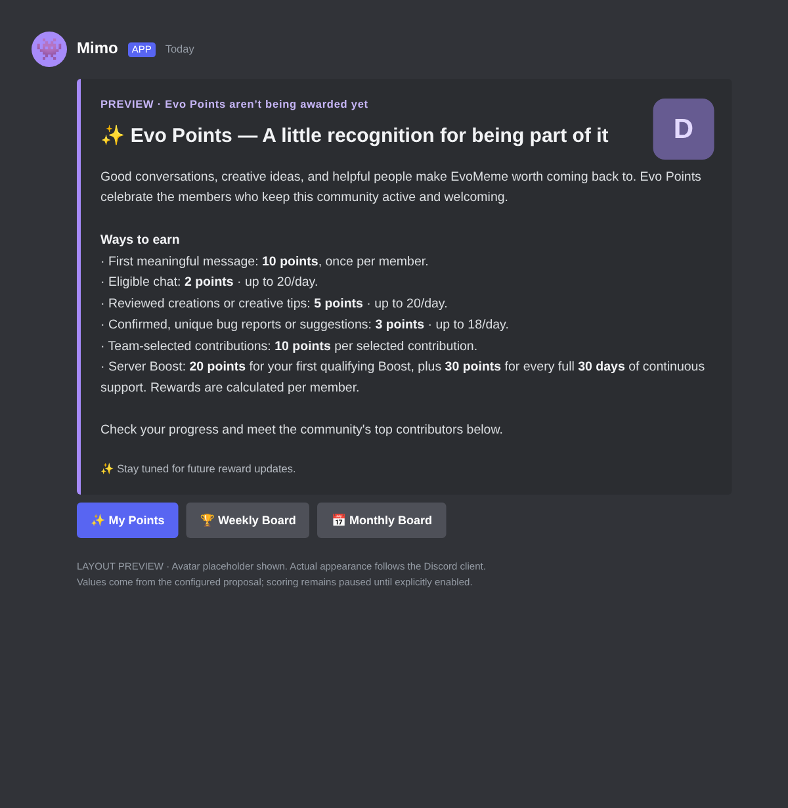

# Evo Points 成员卡片

2026-10-26 按用户在当前会话确认的文案和分值实现。成员端统一显示 **Evo Points / points**，数据库字段、后台积分模块和原有 Slash 指令保留兼容名称。

- `/points rules`、欢迎卡的 Evo Points 入口共用成员介绍卡片。
- 保留紫色侧边、卡片标题、成员头像和服务器图标；Discord 的 Mimo 应用头像由客户端展示。
- 标题、介绍和页脚采用下方定稿。数值从 **已发布配置** 读取，不硬编码成独立于实际规则的广告文字。
- 计分关闭时，作者栏显示 `PREVIEW · Evo Points aren’t being awarded yet`；正文展示已准备好的启用规则，作为待启用方案预览。
- 计分开启时，仅介绍已启用、处于有效期内的规则。消息类规则还需要配置计分频道才会展示。关闭一项 Boost 奖励时不会继续宣传这一项。
- 管理版本号、技术开关、冷却秒数、最低字符数等信息保留在后台，成员卡片不再罗列；成员历史查询仅本人可见。
- 无原生 Onboarding/欢迎自动化行为变化；新卡片不会自动开启计分，也不会发送奖励公告。



截图直接按卡片载荷生成，为结构示意，头像使用占位；实际字体、布局和头像以 Discord 客户端为准。

## 确认的文案

```text
✨ Evo Points — A little recognition for being part of it

Good conversations, creative ideas, and helpful people make EvoMeme worth coming back to. Evo Points celebrate the members who keep this community active and welcoming.

Ways to earn
· First meaningful message: 10 points, once per member.
· Eligible chat: 2 points · up to 20/day.
· Reviewed creations or creative tips: 5 points · up to 20/day.
· Confirmed, unique bug reports or suggestions: 3 points · up to 18/day.
· Team-selected contributions: 10 points per selected contribution.
· Server Boost: 20 points for your first qualifying Boost, plus 30 points for every full 30 days of continuous support. Rewards are calculated per member.

Check your progress and meet the community's top contributors below.
✨ Stay tuned for future reward updates.
```

## 按钮

| 按钮 | 实际行为 |
| --- | --- |
| ✨ My Points | 查询点击者本人的累计积分、等级与榜单名次 |
| 🏆 Weekly Board | 查询当前时区下本周的真实榜单 |
| 📅 Monthly Board | 查询当前时区下本月的真实榜单 |

全部回复仅点击者可见，榜单不会 ping 用户。空榜显示友好提示，不生成示例成员或虚假积分。旧卡片的 `xp:rules` custom ID 保留有效。

## 在已有数据库同步分值

安装源码本身不会覆盖旧的已发布规则。因此旧数据仍需通过后台生成新版本：

1. 更新源码，重新构建前端并重启 API 和 Bot。API、Bot 应使用同一独立 PostgreSQL 数据库。
2. 打开后台 **积分与奖励 → 生成 Evo Points 规则草稿**。
3. 草稿填入 10 / 2 / 5 / 3 / 10 / 20 / 30 这组奖励；创作每日上限 20，问题/建议每日上限 18。官方讨论与活动规则关闭。
4. 计分总开关保持关闭。计分频道、规则有效时间、结算时区和等级门槛沿用当前配置；草稿中仍需检查有效时间和频道是否符合本次启用计划。
5. 核对生成的草稿，点击 **审核通过 → 发布积分规则**。这只切换到新的暂停计分配置，历史积分不变。
6. 在 Discord 再次调用 `/points rules` 或点击欢迎卡的 Evo Points 入口，检查文案和三个按钮。
7. 完成计分频道、Gateway Intents 和奖励流程测试后，再另存并发布总开关开启的新版本。

仅调整卡片展示与按钮无需重新注册 Slash 指令；若要同步指令的英文简介，可按 `docs/XP.md` 重新执行 `npm run bot:register`。

## 验证

本地单元/集成测试包含发布值同步、草稿不会覆盖旧规则、七类预设分值、头像和安全图片域名、卡片大小限制、真实数据按钮路由、本人历史和关闭/过期奖励的隐藏。浏览器测试验证从旧规则生成草稿、明确审核发布、保持暂停状态及原有积分流程。没有使用用户的 Neon 凭证或执行真实 Guild 写入。

本次验证：`npm run lint`、`npm run build`、69 项本地测试及 8 项 Playwright 流程通过。未更新用户本机文件、未修改用户 Neon 中的规则、未在真实 Guild 发送卡片。
